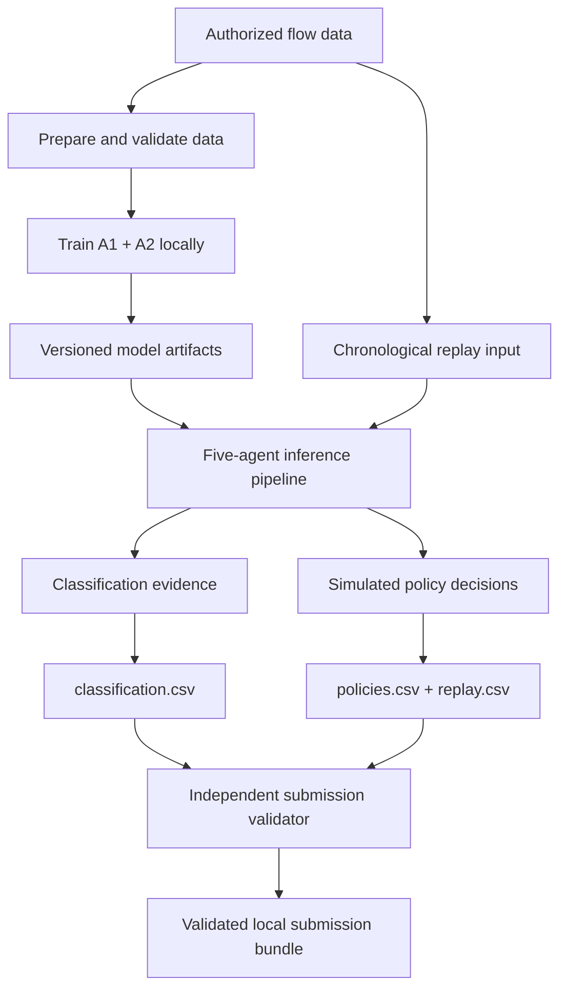
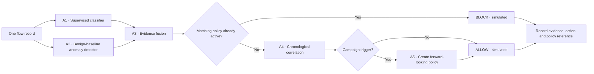
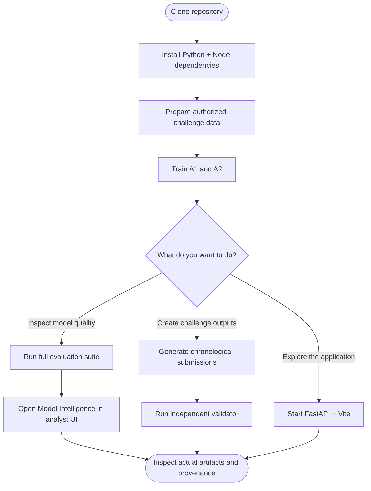
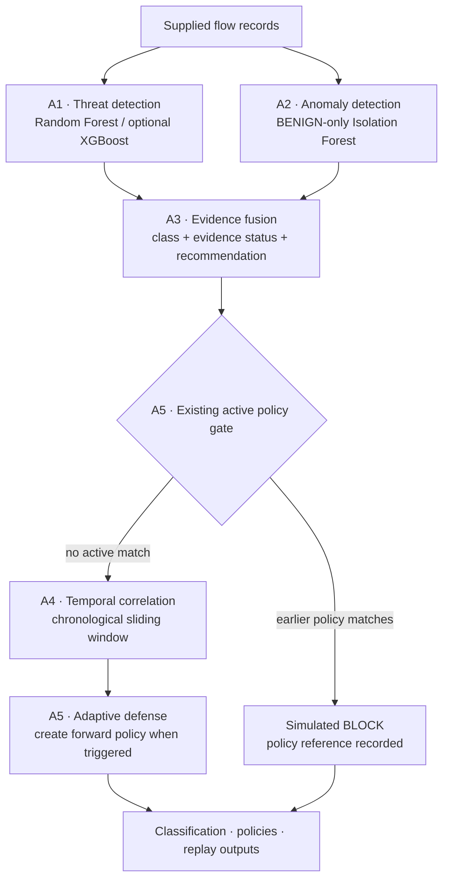

# CyberSentinel

**Multi-Agent Network Intrusion Detection & Adaptive Defense**  
*JAI Agentic AI International Summit 2026 · Track 1: Agentic AI for Cybersecurity*

[](https://github.com/kaustubhdua/jai-hack/actions/workflows/python-tests.yml)
[](https://github.com/kaustubhdua/jai-hack/actions/workflows/frontend-build.yml)

CyberSentinel is an offline, five-agent network-flow intrusion detection and simulated adaptive-defense platform. It combines supervised classification, benign-baseline anomaly detection, deterministic evidence fusion, chronological campaign correlation, and temporary policy enforcement. It includes a FastAPI backend, a React/TypeScript analyst console, local replay and submission tooling, and an extensible ML evaluation suite.

> **Operating boundary:** CyberSentinel evaluates supplied flow records and performs offline chronological replay. `ALLOW`, `BLOCK`, and `REVIEW` are simulated decisions. It does not capture live packets, monitor sockets, inject traffic, or modify operating-system firewalls.

---

## Contents

- [System at a glance](#system-at-a-glance)
- [Five-agent architecture](#five-agent-architecture)
- [Data and model contract](#data-and-model-contract)
- [ML evaluation framework](#ml-evaluation-framework)
- [Evaluation caveats and current evidence](#evaluation-caveats-and-current-evidence)
- [Chronological replay and submissions](#chronological-replay-and-submissions)
- [Analyst console](#analyst-console)
- [Repository layout](#repository-layout)
- [Installation and local operation](#installation-and-local-operation)
- [API reference](#api-reference)
- [Deployment boundary](#deployment-boundary)
- [Security, data, and licensing disclosures](#security-data-and-licensing-disclosures)

## System at a glance

## Visual system map

> **Start here:** the diagrams below show how data becomes model evidence, how evidence becomes a simulated defense decision, and how the project is trained, evaluated, and run. The detailed contracts and commands follow each flow.

### 1. End-to-end product flow



### 2. Five-agent decision pipeline



**Important ordering rule:** only a policy created by an earlier record can block the current record. A trigger record cannot block itself; a newly created policy applies to later records within its activation/expiry window.

### 3. Model and evaluation lifecycle

The model lifecycle is deliberately split into training, evaluation, and hidden-data replay so that evaluation evidence is reproducible and replay decisions do not depend on unavailable labels.

1. **Prepare the training data.** Start with authorized, labelled training records. Audit the input schema and labels, then fit preprocessing steps on the training partition only. Reuse the fitted preprocessing contract for later inference; do not fit transformations on evaluation or hidden replay data.
2. **Train the learned agents locally.**
   - **A1 — supervised detector:** train the five-class classifier using the labelled training partition.
   - **A2 — benign-baseline detector:** fit the Isolation Forest using BENIGN training records only.
3. **Keep artifacts and provenance together.** Save the trained model artifacts and preprocessing/configuration metadata locally. The runtime agents load these artifacts; training is not silently repeated during replay.
4. **Evaluate on a separate labelled partition.** Run the full-system evaluation runner against the separate evaluation partition using the saved artifacts. The evaluation suite produces nine JSON reports and plots covering the configured metrics and analyses.
5. **Expose evaluation results.** The backend evaluation API serves the generated reports to the Model Intelligence dashboard. The dashboard presents evaluation evidence; it does not train models or manufacture metrics.
6. **Run hidden replay independently.** Supply hidden, unlabelled flow records to the chronological replay process. Replay uses the saved artifacts and causal event ordering to generate `classification.csv`, `policies.csv`, and `replay.csv`.
7. **Validate generated submissions.** Run the independent submission validator against the generated files before treating them as deliverables.

Evaluation reports and submission files are generated locally; they are not implied to exist in a clean checkout. Hidden replay labels are not used for decisions. Keep the training, evaluation, and hidden replay partitions separate, and do not use hidden replay outcomes to tune or select models.

### 4. How to use this repository



| Area | Implementation |
|---|---|
| Supervised classification | Agent 1: versioned Random Forest by default; optional XGBoost backend |
| Anomaly detection | Agent 2: Isolation Forest fitted to BENIGN training flows |
| Evidence arbitration | Agent 3: deterministic fusion of A1 and A2 outputs |
| Temporal analysis | Agent 4: stateful chronological correlation |
| Adaptive defense | Agent 5: active-policy checks and forward-looking temporary policies |
| Backend | Python 3.10+ and FastAPI |
| Analyst UI | React 19, TypeScript, Vite, Three.js |
| Local history | SQLite |
| Evaluation | Classification, fusion, anomaly, generalization, LOAO, calibration, temporal, defense, JSON reports and plots |

The application intentionally separates **model classification**, **security action**, and **replay action**. A predicted attack class is not itself proof that a policy blocked the flow. An existing active policy is what causes a replay `BLOCK`; otherwise an analyzed flow is allowed through the simulated replay gate and may create a policy for later records.

## Five-agent architecture



| Agent | Responsibility | Main implementation | Output / behavior |
|---|---|---|---|
| **A1 — Threat Detection** | Supervised five-class flow classification | `src/cybersentinel/agents/threat_detection/` | `predicted_class`, `confidence`; canonical class order is `BENIGN`, `BRUTE_FORCE`, `DOS`, `DDOS`, `PORT_SCAN` |
| **A2 — Anomaly Detection** | Unsupervised deviation from benign baseline | `src/cybersentinel/agents/anomaly_detection.py` | `anomaly_score`, `is_anomaly`, feature-deviation evidence |
| **A3 — Evidence Fusion** | Reconcile A1 and A2 and explain disagreement | `src/cybersentinel/agents/fusion.py` | `final_class`, `evidence_status`, `action`, `rationale` |
| **A4 — Temporal Correlation** | Group suspicious flows over chronological windows | `src/cybersentinel/agents/correlation.py` | Correlation groups, attack type, flow count and evidence |
| **A5 — Adaptive Defense** | Enforce existing simulated rules and create future rules | `src/cybersentinel/agents/adaptive_defense.py` | `ALLOW` / `BLOCK`, policy IDs and expiry metadata |

### A1 — supervised threat detector

The current implementation provides a versioned `ThreatDetectionModel` with a Random Forest default (400 estimators in the combined training CLI) and an optional XGBoost backend. It uses a fixed five-class benchmark vocabulary, a training-fitted median imputer, training-selected numeric feature columns, and balanced class weighting for Random Forest. Identifier-like fields such as record IDs, timestamps, and IP columns are excluded from numeric model features.

The model artifact stores its format version, estimator, imputer, label encoder, feature-column schema, training metadata, and configuration. Loading rejects unsupported artifact versions. Confidence is derived from `predict_proba`; whether it is calibrated depends on the training workflow and is recorded in the generated training manifest.

### A2 — benign-baseline anomaly detector

The Isolation Forest is trained on BENIGN flows only. Its decision function has the conventional direction where lower values indicate more anomalous observations. The evaluation code reverses the sign for ranking metrics so higher anomaly-likelihood scores correspond to more anomalous flows.

The exported anomaly score is a bounded 0–1 anomaly index, **not a calibrated probability**. Its operational flag is based on the model's underlying decision-function threshold. The default threshold is derived from benign training scores. Label-based threshold tuning is opt-in and requires a separate, permitted labelled validation partition.

### A3 — evidence fusion

Fusion combines the typed A1 and A2 result contracts and returns a structured `FusionResult`. The evaluation suite compares A1-only classification with A3's fused class output while measuring ALLOW/REVIEW/BLOCK actions separately. This avoids treating security actions as if they were five-class labels.

### A4 and A5 — chronological correlation and defense

A4 maintains chronological state and detects patterns including port scans, DDoS/DoS activity, and repeated authentication attempts. A5 checks existing policies and manages forward-looking simulated SOURCE_IP policies. The policy manager uses activation and expiry positions so a trigger record cannot block itself.

## Data and model contract

### Benchmark labels

The fixed benchmark classes are:

| Class | Meaning in this project |
|---|---|
| `BENIGN` | Non-attack flow |
| `BRUTE_FORCE` | Brute-force activity |
| `DOS` | Denial-of-service activity |
| `DDOS` | Distributed denial-of-service activity |
| `PORT_SCAN` | Port-scanning activity |

### Documented CICIDS2017 training/evaluation split

The checked-in dataset audit at [`docs/data-intelligence.md`](docs/data-intelligence.md) records the following aggregate properties for the supplied organizer data:

| Split | Rows | Columns | Numeric traffic features |
|---|---:|---:|---:|
| Training | 456,737 | 80 | 78 |
| Evaluation | 114,185 | 80 | 78 |

The 80 columns comprise 78 numeric flow measurements, `record_id`, and `label`. The class distributions are:

| Class | Training rows | Eval rows |
|---|---:|---:|
| `BENIGN` | 240,000 | 60,001 |
| `BRUTE_FORCE` | 5,537 | 1,384 |
| `DOS` | 96,000 | 24,000 |
| `DDOS` | 57,600 | 14,400 |
| `PORT_SCAN` | 57,600 | 14,400 |

The data audit documents null/infinite checks, repeated feature groups, feature overlap across splits, constant columns, exact duplicate columns, and the train-only preprocessing contract. In particular, 8,161 distinct feature vectors occur in both splits and cover 9,795 evaluation rows (8.58%). This can make repeated-flow evaluation optimistic and must be disclosed with benchmark results.

### Preprocessing and leakage controls

The documented `FlowPreprocessor` contract fits preprocessing statistics on the training partition only: convert infinities and invalid negative header lengths to missing values, remove training-identified constant and duplicate features, fill using training medians, and transform evaluation using that fitted schema. Keep row order and evaluation rows intact. Exclude `record_id` from X and keep labels separate from feature inputs.

The current threat model's own `numeric_features` routine independently drops identifier-like fields, converts numeric measurements, and uses a median imputer fitted during model training. These are distinct code paths; use the supported training/prepare commands and the dataset documentation for the intended full data workflow.

### Local-only artifacts

Organizer data, prepared Parquet files, fitted model artifacts under `models/*`, generated reports, replay outputs, and local databases are not normally committed. A repository checkout therefore does not, by itself, prove that runtime model inference or a full replay can execute. Install authorized inputs and train/load compatible model artifacts locally.

## ML evaluation framework

The feature branch associated with [PR #24](https://github.com/kaustubhdua/jai-hack/pull/24) adds a broad, report-oriented evaluation framework spanning all five agents and their interactions. Its modules are exposed through `cybersentinel.evaluation`, driven by `scripts/evaluate_full_system.py`, served through `api/evaluation.py`, and consumed by the React `ModelIntelligence` view.

### Evaluation modules

| Evaluation | Scope | Reported measurements / outputs |
|---|---|---|
| **A1 classification** | Five-class predictions | Accuracy, balanced accuracy, macro/weighted precision-recall-F1, per-class support and metrics, 5×5 confusion matrix, benign false-positive rate and attack detection rate |
| **A1 vs A3 fusion** | Classifier output vs fusion output | Overrides, corrected/damaged cases, net impact, evidence-status distribution; separate ALLOW/REVIEW/BLOCK counts and action rates |
| **A2 anomaly detection** | BENIGN vs attack ranking and operating point | Sign-inverted Isolation Forest ROC-AUC, average precision / PR-AUC, operational benign FPR, attack recall, per-class anomaly rates, score distributions and threshold sweep |
| **Seen vs unseen generalization** | Exact feature-vector hash overlap between training and evaluation | Counts and percentages for seen/unseen patterns, per-class overlap and separate performance metrics |
| **Leave-One-Attack-Out (LOAO)** | Four attack-holdout trials | Hold out BRUTE_FORCE, DOS, DDOS, and PORT_SCAN from A1 training; inspect A1 malicious predictions, A2 anomaly recall, A3 actions, and benign control false-block/review rates |
| **Probability calibration** | Uncalibrated vs calibrated A1 probabilities | ECE, multiclass Brier score, log loss, reliability bins; isotonic and sigmoid/Platt-style calibration comparison using `FrozenEstimator` |
| **A4 temporal evaluation** | Ordered campaign-correlation replay | Campaign counts, precision, false-campaign rate, detection delays, group statistics, and optional shuffled-order robustness analysis |
| **A5 defense evaluation** | Comparative chronological defense simulations | Four configuration summaries, attack containment, benign preservation, false blocking/review, policy counts/reuse, policy expiry checks and temporal enhancement deltas |

### Running the full evaluation

The evaluation runner reads the prepared labelled evaluation and training Parquet files plus the two local model artifacts:

```bash
python scripts/evaluate_full_system.py
```

The runner writes JSON reports to `outputs/evaluation/` and publication-style PNG/SVG plots to `outputs/evaluation/plots/`. The report set consists of:

```text
outputs/evaluation/
├── summary.json
├── classification.json
├── fusion.json
├── anomaly.json
├── generalization.json
├── calibration.json
├── loao.json
├── temporal.json
├── defense.json
└── plots/
    ├── *.png
    └── *.svg
```

Each JSON report includes a report name and metadata such as evaluator version, run timestamp, Git commit (when available), random seed, and SHA-256/size information for the local training/evaluation datasets and model artifacts. These generated files are ignored by Git.

The frontend's Model Intelligence view reads the reports through `GET /api/evaluation/all`. Individual report endpoints and plot-serving routes are described in the [API reference](#api-reference). Missing reports are returned as missing; the application does not infer benchmark metrics from absent files.

> **Important:** PR #24's evaluation modules, tests, API endpoints, and frontend view establish an evaluation implementation and a reproducible report-generation path. They do not establish that the full-data runner has completed on the current local organizer dataset or that report JSON/plot artifacts are currently present. Generate and inspect the reports before publishing numeric performance claims.

## Evaluation caveats and current evidence

The checked-in repository documents the dataset split audit and repeat-feature overlap, but runtime-generated evaluation reports and fitted A1/A2 models are local artifacts. No current numeric score should be presented as the result of the PR #24 runner unless it is taken from a freshly generated report with matching dataset/model hashes.

The evaluation implementation also contains assumptions that should be kept visible when interpreting results:

- **LOAO is a controlled experiment, not a live zero-day guarantee.** It excludes one attack label from A1 training in each trial and measures behaviour on that held-out class. The evaluation script caps the LOAO training sample at 80,000 rows for this run.
- **Calibration data is for tuning diagnostics.** The main training workflow uses a group-isolated stratified holdout from the training partition by default, or a distinct organizer-labelled validation file when explicitly provided. A final unbiased claim still requires an untouched test/validation design.
- **A2 ROC/PR ranking and operational threshold results are different views.** ROC-AUC/PR-AUC use inverted raw Isolation Forest scores; operational FPR/recall use the agent's boolean anomaly flags and selected threshold.
- **Temporal evaluation depends on record order and input fields.** The evaluation module processes rows in their supplied order; ensure the source evaluation data is already in the intended chronology before interpreting campaign metrics.
- **Defense comparisons are simulation results.** Their value depends on the chosen inputs, policy duration, correlation configuration, and policy-state implementation. They are not proof of effectiveness on a live network.
- **Feature-vector hashing rounds numeric features to four decimals** in the generalization evaluator, so “seen” means matching the evaluator's canonicalized signature, not necessarily bitwise-identical raw rows.
- **The framework tests use synthetic fixtures** to test metric shapes, API-facing contracts, and validator behavior. Synthetic test fixtures are not benchmark evidence and are not production dataset results.

## Chronological replay and submissions

The separate Level 2 replay path takes the organizer's unlabelled replay input and generates three CSV files. Its authoritative workflow is documented in [`docs/level2-brief.md`](docs/level2-brief.md), [`docs/judge-disclosures.md`](docs/judge-disclosures.md), and [`docs/evaluation.md`](docs/evaluation.md).

### Causal replay invariants

1. Replay records are processed in input sequence order.
2. Only an already-active policy may block the current record.
3. A record that triggers a new policy is not blocked by the policy it just created.
4. The policy activates on a later record and remains active through its configured expiry record, inclusive.
5. Predictions/classification evidence are retained for every record, including records blocked by a pre-existing simulated policy.
6. Ground-truth labels are not available in the unlabelled hidden replay input and are not used to make hidden replay decisions.

### Submission files

The current documented workflow generates:

| File | Contents |
|---|---|
| `classification.csv` | One row per record with predicted class, anomaly score, and evidence status |
| `policies.csv` | Forward-looking policy records, scope and expiry fields |
| `replay.csv` | One row per record with simulated action and active-policy reference |

Generate the bundle locally after installing the authorized hidden replay input and both trained models:

```bash
python scripts/generate_submissions.py \
  --input data/processed/hidden_replay_input.csv \
  --output-dir outputs/submission
```

Validate it independently:

```bash
python scripts/validate_submissions.py \
  --input data/processed/hidden_replay_input.csv \
  --output-dir outputs/submission
```

The current main-branch documentation describes exact record/order checks, policy activation/expiry semantics, observed-endpoint scope, and the organizer-specific CSV contracts. A local validator pass is not the same as organizer acceptance; only an actual organizer receipt establishes acceptance. A limited `--limit` run is a smoke test, not a complete submission.

### Endpoint provenance

The labelled CICIDS2017 training/evaluation feature partitions contain numeric flow measurements rather than native Layer-3 endpoints. The separate hidden replay input is documented as containing observed `source_ip` and `destination_ip` fields. Agent 4/A5 endpoint-scoped replay must use those literal observed fields. Missing or invalid endpoints remain unknown; the system must not invent IP addresses from TCP fingerprints, hashes, or other synthetic identity construction.

## Analyst console

The React/TypeScript application is mounted from `src/main.tsx` and `src/App.tsx`. The analyst console includes:

1. **SOC overview:** a WebGL schematic of the five-agent system, with a 2D fallback. Visual effects are illustrative, not live traffic telemetry.
2. **Five-agent architecture:** agent responsibilities, model parameters, and input/output contracts.
3. **Flow inspector:** inspect supported flow inputs and actual backend model evidence when the required model artifacts are installed.
4. **Evidence fusion:** manual what-if inputs routed through the backend fusion rules; these are not presented as observed network events.
5. **Temporal investigations:** groups returned by backend chronological replay, with empty/unavailable states when no replay has run.
6. **Adaptive defense:** policy inspection and pre-filter testing against available replay artifacts.
7. **Replay studio:** chronological replay and operational output inspection.
8. **Submission studio:** download and validate locally generated submission artifacts.
9. **Model Intelligence:** tabs for summary, A1 classification, A1/A3 fusion, A2 anomaly analysis, generalization, calibration, LOAO, temporal correlation, adaptive defense, and generated plots.
10. **Audit and local history:** SQLite-backed local run history.
11. **Settings and health:** API/model/data/artifact diagnostics and offline-safety disclosures.

The UI can load without model/data artifacts. In that state, model-backed workflows should be shown as unavailable rather than represented by fabricated predictions, benchmark values, policies, or traffic.

## Repository layout

```text
jai-hack/
├── api/
│   ├── index.py                     # FastAPI app and operational endpoints
│   └── evaluation.py                # Model Intelligence report/plot API
├── docs/
│   ├── data-intelligence.md         # measured dataset audit and prep contract
│   ├── evaluation.md                # training/evaluation/replay instructions
│   ├── level2-brief.md              # Level 2 replay and CSV schemas
│   ├── judge-disclosures.md         # limitations and judge-facing disclosures
│   └── deployment.md                # local/Vercel runtime boundaries
├── scripts/
│   ├── train_models.py              # train A1 and A2 with provenance manifest
│   ├── evaluate_full_system.py      # comprehensive 5-agent ML evaluation
│   ├── generate_submissions.py      # chronological replay and CSV generation
│   ├── validate_submissions.py     # independent submission validation
│   └── prepare_challenge_data.py   # install/check organizer data packs
├── src/
│   ├── cybersentinel/
│   │   ├── agents/
│   │   │   ├── threat_detection/    # A1 model, training and adapter
│   │   │   ├── anomaly_detection.py # A2 Isolation Forest
│   │   │   ├── fusion.py            # A3 fusion contract
│   │   │   ├── correlation.py       # A4 temporal agent
│   │   │   └── adaptive_defense.py  # A5 policy lifecycle
│   │   ├── evaluation/              # per-agent and integrated metrics
│   │   ├── replay/                  # causal replay and validators
│   │   ├── data/                    # local preprocessing tools
│   │   ├── storage/                 # SQLite history
│   │   └── contracts.py             # typed result/policy contracts
│   ├── ModelIntelligence.tsx        # evaluation dashboard
│   ├── main.tsx                     # React entry point
│   └── App.tsx                      # main analyst console
├── tests/
│   └── test_evaluation_framework.py # evaluation contract tests
├── pyproject.toml
├── package.json
└── README.md
```

## Installation and local operation

### Prerequisites

- Python 3.10 or newer.
- Node.js 20 or newer and npm for the React application.
- Authorized organizer datasets for training/evaluation/replay tasks.
- Trained, compatible A1/A2 model artifacts for model-backed analysis.

### Clone and install

```bash
git clone https://github.com/kaustubhdua/jai-hack.git
cd jai-hack

# Backend, evaluation and development dependencies
python -m pip install -e ".[dev,ml]"

# Frontend dependencies
npm install
```

### Prepare challenge data

Use the challenge-pack preparation script and follow its manifest checks:

```bash
python scripts/prepare_challenge_data.py \
  --training-pack cyber-pack.zip \
  --hidden-pack cyber-hidden.zip
```

The resulting raw/processed data paths are local and git-ignored. Consult `python scripts/prepare_challenge_data.py --help` and the data handoff documents for the accepted pack format and expected files.

### Train the two learned agents

```bash
python scripts/train_models.py --train data/raw/training/flows.parquet
```

By default, A1 uses a group-isolated stratified holdout from training for confidence calibration, and A2 fits the BENIGN training subset. The output manifest records artifact/data hashes, training/validation provenance, and whether the confidence/threshold were calibrated. A separate validation dataset can be supplied only when it is a distinct permitted partition:

```bash
python scripts/train_models.py \
  --train data/raw/training/flows.parquet \
  --validation /path/to/organizer-labelled-validation.parquet
```

Anomaly threshold calibration from labelled validation is opt-in with `--calibrate-anomaly-threshold`; it must not be enabled without the separate validation partition. Do not use the hidden set or final evaluation split for training or calibration.

### Run the evaluation suite

After preparing labelled train/evaluation Parquet files and training both models:

```bash
python scripts/evaluate_full_system.py
```

This writes the nine JSON reports and plot outputs to `outputs/evaluation/`. Review report metadata and caveats before communicating any scores.

### Run offline replay and validate outputs

```bash
python scripts/generate_submissions.py \
  --input data/processed/hidden_replay_input.csv \
  --output-dir outputs/submission

python scripts/validate_submissions.py \
  --input data/processed/hidden_replay_input.csv \
  --output-dir outputs/submission
```

### Run tests

```bash
python -m pytest tests -q
```

The PR #24 evaluation test module includes small synthetic fixtures for deterministic metric/contract tests. Those fixtures validate software behavior and do not substitute for full-data benchmark runs.

### Start the backend

```bash
uvicorn api.index:app --host 127.0.0.1 --port 8000
```

### Start the frontend

In a second terminal:

```bash
npm run dev
```

The Vite development server proxies `/api` to the local FastAPI service on `127.0.0.1:8000`.

### Build the frontend

```bash
npm run build
```

## API reference

The FastAPI application mounts the evaluation router under `/api/evaluation`.

### Evaluation reports

| Method | Route | Purpose |
|---|---|---|
| GET | `/api/evaluation/all` | Return all report payloads plus `ready`, `partial`, or `not_generated` status and a missing-report list |
| GET | `/api/evaluation/summary` | Executive summary report |
| GET | `/api/evaluation/classification` | A1 five-class classification metrics |
| GET | `/api/evaluation/fusion` | A1 vs A3 fusion comparison |
| GET | `/api/evaluation/anomaly` | A2 Isolation Forest evaluation |
| GET | `/api/evaluation/generalization` | Seen/unseen feature analysis |
| GET | `/api/evaluation/calibration` | A1 calibration report |
| GET | `/api/evaluation/loao` | Four-trial leave-one-attack-out report |
| GET | `/api/evaluation/temporal` | A4 temporal campaign report |
| GET | `/api/evaluation/defense` | A5 adaptive defense comparison |
| GET | `/api/evaluation/plots/{filename}` | Serve a generated PNG/SVG plot from the evaluation plot directory |

The evaluation API reads generated JSON/plot artifacts from local `outputs/evaluation/`; it does not generate them on request. A report endpoint can therefore return not-found until the evaluation runner has completed.

### Operational routes

The main API also includes system health/diagnostics, inference, replay, submission downloads, flow inspection, policies, and correlation/history endpoints. Use the running application's OpenAPI schema at `/docs` as the authoritative live route inventory for the checked-out commit:

- `GET /api/health` and `GET /health` — API liveness and model readiness.
- `GET /api/system/diagnostics` — local model/data/submission/history artifact presence.
- `GET /api/overview` — overview metrics derived from available local artifacts; labelled metrics are only possible where labels are present.
- `POST /api/fusion/simulate` — run the backend evidence-fusion rules on supplied what-if inputs.
- `POST /api/replay/run-official` — run the locally installed hidden replay input through the chronological replay engine.
- `GET /api/correlation/groups` — correlation groups from the most recent replay in the current API process.
- `GET /api/submissions/download/{filename}` — download supported generated submission/report files.

Routes that require absent data/model artifacts return an explicit unavailable/error response. A functioning UI or API liveness response does not mean learned models are ready.

## Deployment boundary

The documented and authoritative workflow is local/offline. The repository is connected to Vercel, but Git deployments do not include git-ignored organizer datasets or fitted models. The deployment notes record that the frontend/API bundle can be packaged while model-backed endpoints remain unavailable until authorized artifacts are provisioned.

Additional limitations documented in `docs/deployment.md`:

- The Vercel Python function has a 30-second configured maximum duration; full replay may exceed it.
- Run history uses local SQLite, not durable shared storage across serverless instances.
- A Vercel READY deployment indicates build/deployment state, not end-to-end model readiness, full replay success, or official organizer acceptance.
- Preview SSO can prevent unauthenticated external browser verification.

Do not present the hosted deployment as a production-ready live SOC service unless its data/model provisioning, durable storage, complete replay, API routes, and browser workflows have been independently tested in that environment.

## Security, data, and licensing disclosures

- **Offline-only defense:** no live packet capture, socket monitoring, traffic injection, or OS firewall mutation.
- **Endpoint provenance:** labelled CICIDS2017 flow features do not provide native Layer-3 endpoints; the separate hidden replay input is documented as endpoint-enriched. Never manufacture IP identity from fingerprints or hashes.
- **Dataset permissions:** organizer/CICIDS2017 data is subject to provider and challenge terms. Raw challenge records and fitted local artifacts are not committed.
- **Evaluation transparency:** disclose the 8.58% repeated feature-vector overlap and distinguish generated results from historical reports or synthetic test fixtures.
- **Model artifact safety:** model artifacts use joblib/pickle serialization. Load only artifacts from trusted provenance.
- **Project license:** MIT License; see [`LICENSE`](LICENSE). Third-party dependency and dataset terms continue to apply.
- **AI assistance:** the team reports using Antigravity and ChatGPT for code review, debugging, test design, documentation, and UI implementation assistance. Team members remain responsible for understanding and presenting the submitted code.


Historical release and QA notes are indexed in [`release/README.md`](release/README.md). Their old pass statuses are historical snapshots, not current verification for this commit.
