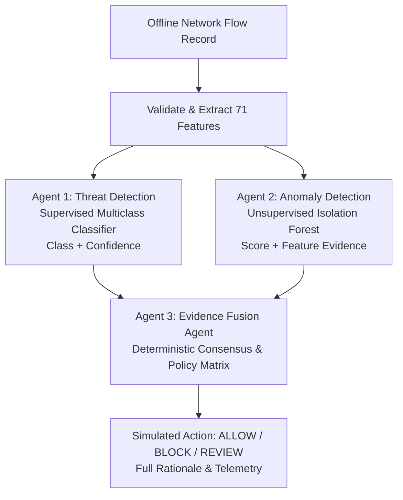

# CyberSentinel System Architecture

## Overview

CyberSentinel is an offline, multi-agent network intrusion detection and adaptive defense analysis framework. It evaluates CICIDS2017 network flow records across five benchmark classes using two independent detection agents and a deterministic evidence fusion engine.

## Agent Responsibilities

1. **Agent 1 (Threat Detection Agent):**
   - Implements supervised five-class classification (`BENIGN`, `BRUTE_FORCE`, `DOS`, `DDOS`, `PORT_SCAN`).
   - Uses class-weighted Random Forest (400 estimators, max depth 20).
   - Generates model-derived maximum probability confidence scores.
   - Preserves sub-millisecond inference latency (~0.016 ms/flow).

2. **Agent 2 (Anomaly Detection Agent):**
   - Independent baseline trained strictly on 240,000 `BENIGN` flows.
   - Uses Isolation Forest (200 trees, 1st percentile training score threshold $\approx 0.0332$).
   - Flags deviations without consuming Agent 1 outputs or labels.
   - Extracts feature-level evidence tags (e.g. `unusual_packet_rate`, `abnormal_flow_duration`).

3. **Agent 3 (Evidence Fusion Agent):**
   - Orchestrates deterministic consensus between Agent 1 and Agent 2.
   - Evaluates agreement, disagreement, confidence floors, and failsafe modes.
   - Emits simulated policy recommendations: `ALLOW`, `BLOCK`, or `REVIEW`.
   - Never applies live firewall changes or modifies network interfaces.

## Pipeline Safety & Degraded Modes

The pipeline guarantees:
- Independent execution: failure in one agent is caught and surfaced as an `error` status rather than causing a system crash.
- Incomplete evidence fails closed to `REVIEW`.
- Disagreement between agents requires operator review (`REVIEW`).
