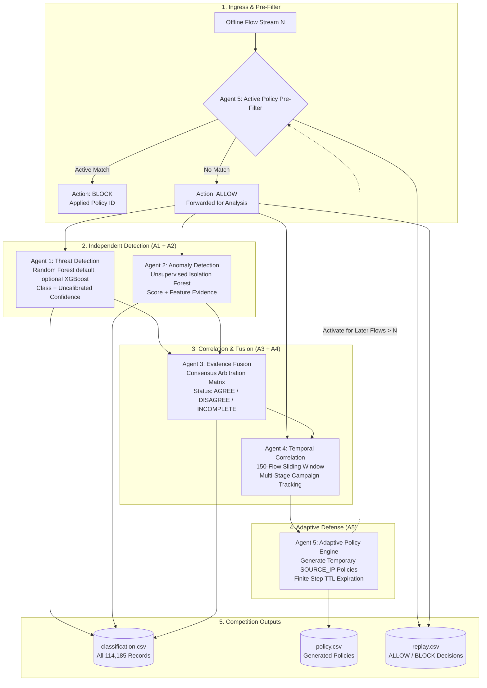

# CyberSentinel System Architecture

## Overview

CyberSentinel is an offline, five-agent network intrusion detection and adaptive defense framework built for JAI 2026 Hackathon Track 1. It evaluates CICIDS2017 network flow records across five benchmark classes using two independent detection agents, an evidence fusion matrix, a temporal correlation engine, and an adaptive policy manager.

## Five-Agent Responsibilities

1. **Agent 1 (Threat Detection Agent):**
   - Implements supervised five-class classification (`BENIGN`, `BRUTE_FORCE`, `DOS`, `DDOS`, `PORT_SCAN`).
   - Uses the current `RandomForestClassifier` backend by default (400 estimators, `balanced_subsample` class weights); XGBoost is an optional backend. Missing and infinite numeric values are median-imputed from training data.
   - Outputs the predicted class and the maximum `predict_proba` value. This model-derived confidence is not probability-calibrated.

2. **Agent 2 (Anomaly Detection Agent):**
   - Independent baseline trained strictly on benign baseline network traffic.
   - Uses a 200-tree Isolation Forest trained on benign training rows; its threshold is the first percentile of training decision scores. The score is not a probability.
   - Flags deviations without consuming Agent 1 outputs or labels.
   - Extracts feature-level evidence tags (e.g., `unusual_packet_rate`, `abnormal_flow_duration`).

3. **Agent 3 (Evidence Fusion Agent):**
   - Orchestrates deterministic consensus between Agent 1 and Agent 2.
   - Evaluates agreement (`AGREE`), disagreement (`DISAGREE`), and incomplete evidence (`INCOMPLETE`).
   - Routes conflicting or ambiguous predictions safely to fail-closed `REVIEW`.

4. **Agent 4 (Temporal Correlation Agent):**
   - Maintains a stateful 150-flow sliding window across arrival order.
   - Correlates isolated probes into multi-stage campaigns using literal observed endpoints where present. If native source IP is absent, the current fallback derives an IP-shaped synthetic identity from `Init_Win_bytes_forward`, `min_seg_size_forward`, and `Fwd Header Length`; it is not an observed address and can collide. Destination IP is never synthesized. DDoS and brute-force heuristics require matching A1 attack-class evidence; ordinary web fan-in or repeated benign SSH flows alone do not trigger those campaigns.
   - Extracts target endpoints, member records, and threat group IDs.

5. **Agent 5 (Adaptive Defense Agent):**
   - Evaluates active policies before newly allowed flows are analyzed.
   - Generates temporary `SOURCE_IP` quarantine policies with explicit activation and expiration boundaries (`expires_after_record_id`). The scope is an observed IP when available, otherwise the disclosed synthetic identity; the default 150-position lifetime is fixed.
   - Strictly enforces that the triggering flow is never self-blocked.
   - Never applies live firewall changes; all policies are simulated within the replay framework.

## Replay Engine & Causal Invariants

The chronological replay engine enforces strict causality guarantees:
- **Arrival-Order Processing:** Flows are evaluated strictly sequentially.
- **Pre-Filter First:** Only policies activated prior to record $N$ can drop flow $N$.
- **Universal Forensics:** Every flow, including those blocked by earlier policies, is classified in `classification.csv`.
- **Zero Label Leakage:** Ground-truth labels are never accessed during replay decision making.