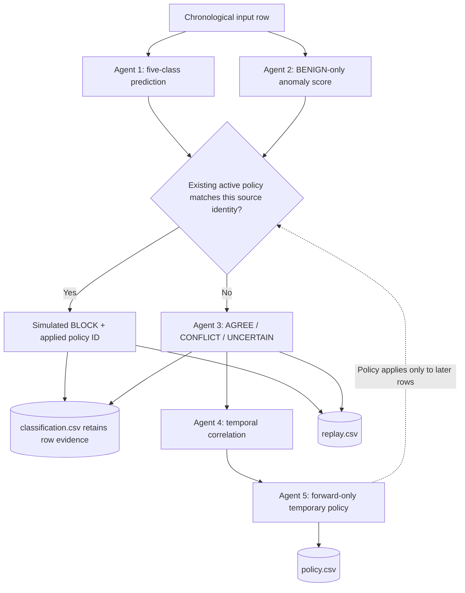

# CyberSentinel — Level 2 Multi-Agent Architecture & Competition Strategy

## 1. System Overview

For JAI 2026 Track 1 (Agentic AI for Cybersecurity), CyberSentinel delivers a 5-agent multi-agent intrusion detection and causal adaptive defense system operating in an offline traffic-replay environment.



---

## 2. Five-Agent Responsibilities

| Agent | Responsibility | Key Outputs | Implementation |
| :--- | :--- | :--- | :--- |
| **Agent 1: Threat Detection** | Supervised multi-class classification across 5 benchmark classes. | `predicted_class`, `confidence` | `src/cybersentinel/agents/threat_detection/` |
| **Agent 2: Anomaly Detection** | Unsupervised outlier scoring trained strictly on benign baseline. | `anomaly_score`, `is_anomaly`, `evidence` | `src/cybersentinel/agents/anomaly_detection.py` |
| **Agent 3: Evidence Fusion** | Deterministic AGREE/CONFLICT/UNCERTAIN reconciliation. | `final_class`, `evidence_status`, `action`, `rationale` | `src/cybersentinel/agents/fusion.py` |
| **Agent 4: Temporal Correlation** | Correlates sliding-window endpoints to identify coordinated attacks. | `group_id`, `attack_type`, `group_size`, `evidence` | `src/cybersentinel/agents/correlation.py` |
| **Agent 5: Adaptive Defense** | Evaluates active policies & creates forward-looking temporary blocks. | `action`, `applied_policy_id`, `new_policy` | `src/cybersentinel/agents/adaptive_defense.py` |

---

## 3. Submission Files Generator

The hidden input must be processed in organiser `seq` order. It carries observed `source_ip`, `destination_ip`, `day`, and `time_offset` metadata; the replay engine preserves the input order and converts the minute-second offsets into timestamps for Agent 4.

Run the 5-agent chronological replay engine to produce the three official competition CSV files:

```bash
python scripts/generate_submissions.py \
  --input data/processed/hidden_replay_input.csv \
  --output-dir submissions/
```

### Expected Output CSVs:

1. **`classification.csv`**:
   `record_id,predicted_class,anomaly_score,evidence_status`
   * Contains one row per input flow regardless of whether it was later blocked.
2. **`policy.csv`**:
   `policy_id,activated_after_record_id,scope_type,scope_value,expires_after_record_id,policy_action`
   * Logs every defensive policy generated after an analyzed attack flow.
3. **`replay.csv`**:
   `record_id,action,applied_policy_id`
   * Every record in exact replay order. Pre-filtered matching records are `BLOCK` with valid `applied_policy_id`. Allowed records are `ALLOW` with empty `applied_policy_id`.

---

## 4. Key Talking Points for Judges & Panel Demonstration

1. **Strict Causal Replay Discipline:**
   * Never uses future records or ground-truth labels during decision making.
   * Policies only apply to *later* incoming records, strictly adhering to real-world causality.
2. **Pre-Filter Action Gate:**
   * A1/A2 classification and A3 evidence-fusion outputs are still computed for every row because `classification.csv` requires one prediction per record, including records later blocked. The active-policy check determines the replay action before Agent 4 correlation and Agent 5 policy updates; blocked rows do not enter those later state updates. This is simulated replay behavior, not a measured inference-speed optimization. When native source IP is absent, the replay engine derives a synthetic IP-shaped source identity from three TCP-stack fingerprint fields. It is not observed and can collide, potentially causing false blocks; destination IP is never synthesized. See the [scope audit](../release/benchmarks/source-ip-scope-audit.md).
3. **Defense-in-Depth Trade-Off:**
   * Report only metrics reproduced on the current code and authorized data. Include macro-F1 and per-class results, state the evaluation split and its repeated-feature overlap, and describe ALLOW/BLOCK/REVIEW as simulated actions. Older release reports contain historical figures, not current results.

